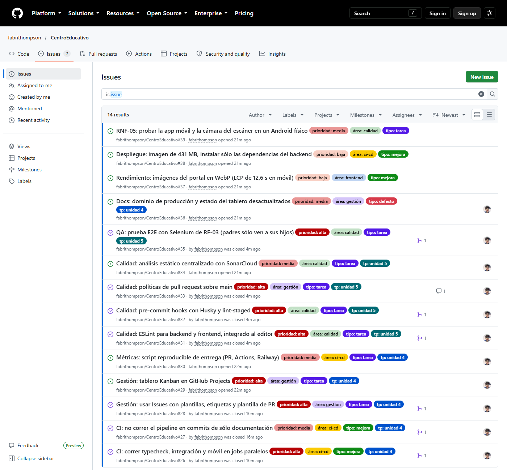
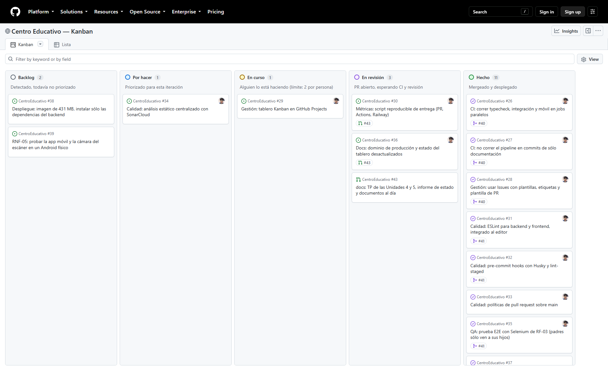
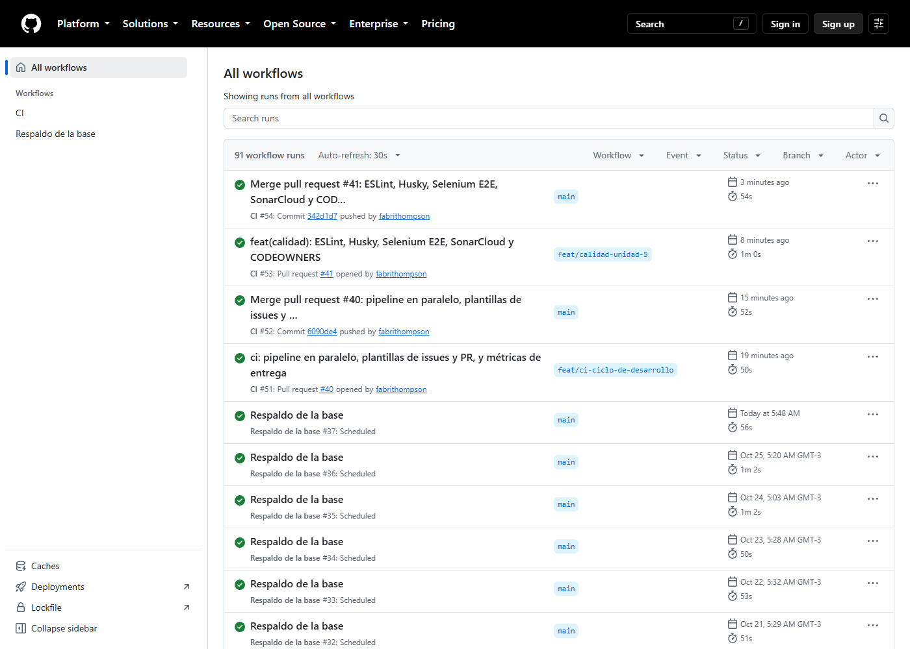
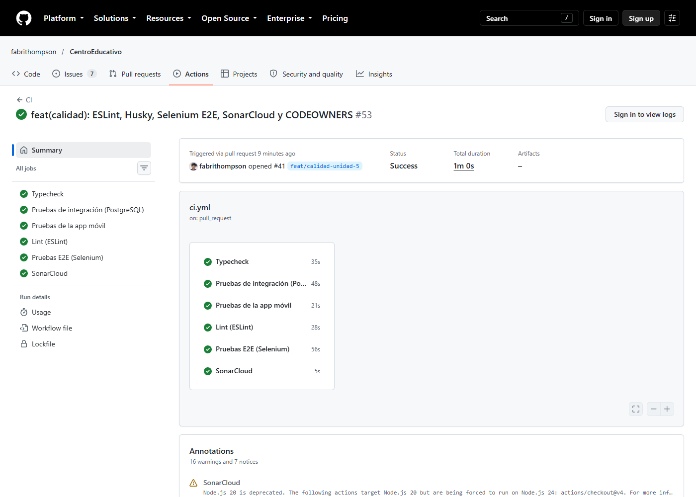

# TP Unidad 4 — Optimización del ciclo de desarrollo

**Metodología de Sistemas II** · Tecnicatura Universitaria en Programación · 2026

**Equipo Naft:** Nahuel Alem · Fabricio Ceniquel Thompson

**Proyecto:** Sistema Integral de Gestión — Centro Educativo «Educar para Transformar» (Resistencia, Chaco)

**Repositorio:** <https://github.com/fabrithompson/CentroEducativo> · **Producción:** <https://transformar-para-educar.up.railway.app>

Las mediciones de este documento se tomaron el **26/10/2026** con scripts que quedan en el repositorio (`scripts/metricas/`), así que cualquiera puede repetirlas.

<!-- salto -->

# PARTE 1

> La consigna pide que esta parte sea individual. Las respuestas parten de la experiencia del equipo con el proyecto: cada integrante puede ajustarlas antes de entregar su PDF.

## Actividad 1 — Verdadero o falso

| Contenido | V o F | Justificación |
| --- | --- | --- |
| **Flujo típico de Integración Continua.** El desarrollador sube el cambio; el servidor de CI compila, corre pruebas unitarias y de integración y analiza la calidad; si todo pasa se puede fusionar, y si falla se notifica al equipo. | **V** | Es exactamente lo que hace nuestro CI en GitHub Actions: en cada push y en cada PR corre typecheck, lint, pruebas de integración contra PostgreSQL, pruebas de la app móvil y Selenium. El merge a `main` queda bloqueado si algo falla, y GitHub notifica por correo. |
| **Proceso de Integración Continua.** Ramas separadas que se integran con frecuencia en la principal; el servidor compila y prueba automáticamente; si hay error se notifica para corregirlo rápido. | **V** | Describe el flujo de ramas por funcionalidad con PR hacia `main`. La notificación temprana es lo que evita que un error se acumule con otros. |
| **Principios clave de la CI.** Integrar con frecuencia, mantener el código listo para desplegar, automatizar pruebas, usar control de versiones y revisar los resultados del CI antes de aprobar merges. | **V** | Son los cinco principios. El último lo implementamos como regla: la protección de `main` exige los seis chequeos en verde para mergear. |
| **Relación con Entrega Continua (CD).** La CI asegura que el código nuevo se integre bien; la Entrega Continua automatiza el despliegue en entornos de prueba o producción; juntas forman el flujo CI/CD. | **V** | Con una precisión: en la *entrega* continua el código queda siempre listo y el paso a producción puede requerir una aprobación manual; cuando también es automático se habla de *despliegue* continuo. Nuestro proyecto hace despliegue continuo: Railway publica solo cada merge a `main`. |
| **Flujo típico de un pipeline CI/CD.** Commit → Build → Test → Package → Deploy → Notify. | **V** | Coincide con nuestro pipeline: push → GitHub Actions (build con `tsc`, pruebas) → Railway construye la imagen (package) → aplica migraciones y despliega → GitHub y Railway notifican el resultado. |
| **Etapas típicas del despliegue automatizado.** Build, Test, Package, Deploy, Verify. | **V** | En nuestro caso, *Verify* hoy es parcial: si las migraciones fallan en el pre-deploy, Railway no publica y queda sirviendo la versión anterior, y la aplicación expone `GET /health`. Pero Railway todavía no está configurado para consultar ese endpoint antes de pasarle tráfico (`healthcheckPath`): es una mejora pendiente. |

## Actividad 2 — Beneficios de la Integración Continua

| Beneficio | Descripción |
| --- | --- |
| Detección temprana de errores | Los fallos se detectan en minutos, no semanas después. |
| Reducción de conflictos de integración | Al integrar frecuentemente, se evitan «infiernos de merge». |
| Mayor calidad del software | Las pruebas automáticas garantizan estabilidad. |
| Entrega más rápida | El producto está siempre en condiciones de ser desplegado. |
| Transparencia | Todos pueden ver el estado del proyecto (builds, pruebas, cobertura). |

## Actividad 3 — Herramienta propuesta: Dependabot

Proponemos **Dependabot**, el servicio de GitHub que vigila las dependencias del proyecto y abre solo un *pull request* cuando hay una versión nueva o una vulnerabilidad publicada.

**Por qué para este proyecto:**

- El sistema maneja datos personales de menores, domicilios y teléfonos de los tutores. Una dependencia con una vulnerabilidad conocida (en `express`, `jsonwebtoken`, `multer` o `bcrypt`, por ejemplo) es un riesgo concreto, y hoy nadie revisa eso en forma sistemática. Al instalar, pnpm ya informa nueve subdependencias deprecadas.
- **Se integra con lo que ya está**: cada PR de Dependabot pasa por el mismo CI (typecheck, integración, E2E), así que una actualización que rompe algo se ve antes de mergear y no en producción.
- **Es gratis** para repositorios públicos y se configura con un solo archivo, `.github/dependabot.yml`: ecosistema `npm` (es compatible con pnpm), frecuencia semanal y agrupación de actualizaciones menores para no llenar el repositorio de PR.
- **Cierra el ciclo con la Unidad 3**: mantener las dependencias al día es una buena práctica que, sin automatizar, depende de la memoria de alguien.

## Actividad 4 — Preguntas

### Relación entre la Unidad 3 (buenas prácticas de programación) y la Unidad 4

La Unidad 3 dice *qué* es código de calidad: nombres claros, funciones chicas, manejo de errores, pruebas, control de versiones, revisión entre pares y convenciones compartidas. La Unidad 4 dice *cómo garantizar que se cumpla siempre*, sin depender de que alguien se acuerde. Cada buena práctica tiene su control automático:

| Buena práctica (Unidad 3) | Cómo la hace cumplir el CI/CD (Unidad 4) | En este proyecto |
| --- | --- | --- |
| Convenciones de estilo y código limpio | Linter en el pipeline y antes de cada commit | ESLint en el editor, en Husky y en el CI |
| Pruebas automatizadas | El pipeline las corre en cada cambio | 382 pruebas + 3 E2E en cada PR |
| Control de versiones y commits descriptivos | Hooks que validan el mensaje | `commit-msg` exige Conventional Commits |
| Revisión entre pares | PR obligatorio antes de integrar | Protección de `main` + `CODEOWNERS` |
| No romper lo que funciona | Pruebas de regresión antes del merge | Selenium verifica RF-03 en cada PR |
| Configuración fuera del código | Variables de entorno por entorno | `.env.example` en local; variables de Railway en producción |

### ¿Cómo modifica CI/CD el proceso tradicional y qué beneficios aporta?

En el proceso tradicional, cada integrante trabaja aislado durante semanas, la integración es una fase al final, las pruebas se hacen a mano cuando hay tiempo y el despliegue es una tarea manual y riesgosa. CI/CD lo invierte: se integra varias veces por día, cada cambio se verifica solo y el despliegue pasa a ser un evento rutinario.

- **Calidad**: cada cambio pasa por los mismos controles, sin excepciones. En este proyecto, un despliegue anterior llegó a producción sin aplicar las migraciones porque dependía de que alguien las corriera a mano; hoy el pre-deploy de Railway las aplica siempre y, si fallan, no publica.
- **Tiempo**: el CI da una respuesta en menos de un minuto y medio. Del merge a la aplicación respondiendo en producción pasan entre 3 y 5 minutos, sin intervención humana.
- **Trazabilidad**: cada cambio en producción se puede seguir hacia atrás: despliegue de Railway → commit → PR → issue que lo pidió. Antes de este TP faltaba la última parte: había 0 issues y el 53 % de los commits llegaba a `main` sin PR.
- **Productividad**: el equipo deja de gastar tiempo en tareas repetitivas (compilar, probar, desplegar, respaldar la base) y lo dedica a funcionalidades. El respaldo diario de la base, por ejemplo, corre solo y además se verifica restaurándolo.

### ¿Qué mejoras introduce CI/CD en el trabajo colaborativo y en la calidad?

- **Una sola fuente de verdad**: lo que dice el CI es lo que vale para los dos integrantes. Se termina el «en mi máquina anda».
- **La revisión se enfoca en lo importante**: si el linter y las pruebas ya pasaron, la revisión humana puede concentrarse en la lógica y en las reglas de negocio, no en el formato.
- **Integración frecuente y en partes chicas**: los PR chicos se revisan rápido y generan menos conflictos. Una de las mediciones de este TP muestra lo contrario: el 29/09 se empujaron seis cambios seguidos directamente a `main` y los despliegues se encolaron hasta 34 minutos.
- **Visibilidad compartida**: el tablero Kanban, los issues y el estado del CI muestran a todos qué se está haciendo, qué está bloqueado y qué ya está en producción.

### ¿Cómo se podría incorporar la IA a los contenidos de la Unidad 4?

- **Revisión de PR asistida**: un modelo de IA comenta cada PR antes de la revisión humana. Detecta posibles defectos y verifica la lista de control de la plantilla.
- **Diagnóstico de fallas del pipeline**: ante un job en rojo, la IA lee el log y resume la causa probable. En este proyecto se usó así para descubrir que el build de Railway fallaba por el builder, no por el código.
- **Generación de pruebas**: proponer casos de prueba a partir de los criterios de aceptación de un issue, que una persona revisa antes de incorporarlos.
- **Análisis de métricas**: leer las métricas de entrega, como las de este TP, y señalar cuellos de botella y tendencias.
- **Infraestructura como código**: redactar y revisar archivos de pipeline y de infraestructura (`ci.yml`, `.railway/railway.ts`).

El equipo ya usa IA en el desarrollo y registra cada intervención en `docs/bitacora_ia.md`, como exige la materia. La condición para que sume y no reste es la misma que para cualquier otro aporte: **nada de lo que propone la IA llega a `main` sin pasar por el CI y por la revisión de una persona**.

<!-- salto -->

# PARTE 2

## Tipo de optimización aplicada

**Optimización del flujo de entrega mediante CI/CD (despliegue continuo), guiada por métricas.**

El equipo automatizó el camino completo del código desde el commit hasta producción: integración continua en GitHub Actions, despliegue continuo en Railway e infraestructura declarada como código. En este TP se sumó la otra mitad, que es medir ese flujo, encontrar dónde se pierde tiempo y corregirlo, en la línea de las métricas DORA (frecuencia de despliegue, tiempo de entrega de un cambio, tasa de fallos y tiempo de recuperación).

**Por qué este tipo de optimización:**

1. **Un equipo de dos personas no puede gastar tiempo en tareas manuales.** Compilar, probar, migrar la base, desplegar y respaldar se hacen solos.
2. **El costo de un error en producción es alto**: datos de menores, facturación y avisos a las familias. Ningún cambio llega sin pasar por las pruebas.
3. **Ya hubo incidentes por pasos manuales**: migraciones que no se aplicaron, un builder mal configurado y despliegues salteados en silencio. Están documentados en `docs/despliegue.md`, y cada uno terminó convertido en una regla automática.
4. **Sin medir no se sabe qué optimizar**: la línea base de este TP encontró cuellos de botella que no eran evidentes, como que el 42 % de las corridas del CI fueran sobre cambios de documentación.

**Herramientas:**

| Etapa | Herramienta |
| --- | --- |
| Repositorio y colaboración | GitHub: ramas, PR, Issues, Projects, protección de rama |
| Integración continua | GitHub Actions (`.github/workflows/ci.yml`) |
| Calidad estática | ESLint, Husky + lint-staged, SonarCloud |
| Pruebas | Ejecutor nativo de Node (`node --test`), PostgreSQL real, Selenium WebDriver |
| Despliegue continuo | Railway (Railpack) con infraestructura como código (`.railway/railway.ts`) |
| Operación | Health check `/health`, respaldo diario con restauración verificada (`respaldo.yml`) |
| Métricas | `scripts/metricas/entrega.mjs` (GitHub + Railway) y `scripts/metricas/lighthouse.mjs` |

## Funcionalidad seleccionada: alta de alumnos (RF-01)

**Requerimiento:** registrar los datos personales de los alumnos (legajo, DNI, nombre, apellido, nivel y curso) sin registros duplicados.

**Cómo funciona:** el administrador entra al backoffice (*Panel de administración → Alumnos → Nuevo alumno*), completa el formulario y guarda. El legajo se genera solo. Si el DNI ya existe, el sistema lo rechaza con un mensaje claro: lo garantiza un índice único en la base (`Alumno.dni @unique`), no sólo el formulario.

**Por qué la elegimos:** es la funcionalidad con más evidencia de que está completa y funcionando:

- Una prueba de humo recorre el circuito entero por HTTP contra PostgreSQL real, como lo haría el panel: ingreso como administrador, creación de nivel, curso y materia, alta del alumno y rechazo del DNI repetido. Son 21 comprobaciones (`pnpm --filter backend test:humo`).
- Tiene tiempos medidos con una matrícula de 5012 alumnos en producción: el listado paginado responde en 2,40 s y la búsqueda por apellido en 0,66 s, contra un umbral de 3 s.
- Está explicada paso a paso en `docs/manual_de_usuario.md`.

**Cómo la atraviesa el ciclo CI/CD:** cualquier cambio en el módulo `alumnos` pasa por typecheck, lint y la suite de integración, que verifica el rechazo del DNI duplicado en el motor. Después del merge a `main`, Railway construye la imagen, aplica las migraciones y publica, sin pasos manuales.

## Tabla de contenidos de la Unidad 4

Estado relevado el 26/10/2026, **antes** de las mejoras de este TP. Las dos filas marcadas con ★ eran contenidos no aplicados que se implementaron como parte del TP.

| Contenido | Aplicado | No aplicado | Herramientas y estrategias (si se aplica) o flujo de ejemplo (si no) |
| --- | --- | --- | --- |
| Integración Continua | ✔ | | **GitHub Actions** (`ci.yml`) en cada push y PR a `main` y `developer`: typecheck, pruebas de integración contra PostgreSQL real (service container), pruebas de la app móvil y, desde este TP, lint y E2E con Selenium. 50 corridas en la línea base, con 98 % de éxito. |
| Despliegue Continuo | ✔ | | **Railway** conectado al repositorio: cada push a `main` despliega solo. `checkSuites: true` hace que espere al CI en verde. El *pre-deploy* aplica las migraciones de Prisma, y si fallan sigue sirviendo la versión anterior. |
| Build | ✔ | | `pnpm build` = `prisma generate && tsc`: genera el cliente de la base y compila TypeScript a `web/backend/dist/`. Corre en Railway con **Railpack**, con Node fijado en 22.13 por `.nvmrc`, la misma versión que el CI. |
| Pipelines | ✔ | | Dos workflows. **CI**: 6 jobs paralelos (typecheck, integración, móvil, lint, E2E, SonarCloud). **Respaldo**: todos los días a las 00:15, `pg_dump` → verificación → cifrado AES-256 → artifact → restauración en una base limpia → conteo de tablas. Más el pipeline de Railway: build → pre-deploy → deploy → health check. |
| Variables de Entorno | ✔ | | `web/backend/.env.example` con los nombres (`DATABASE_URL`, `JWT_ACCESS_SECRET`, `JWT_REFRESH_SECRET`, `CORS_ORIGIN`, `SMTP_*`, `UPLOAD_DIR`, etc.); `.env` está en `.gitignore`. En producción, variables del servicio de Railway (declaradas con `preserve()` en la IaC, sin valores en el código). En CI, **GitHub Secrets** (`DATABASE_URL_RESPALDO`, `RESPALDO_PASSPHRASE`, `SONAR_TOKEN`). |
| Gestión de Artefactos | Parcial | | Los **respaldos** de la base se guardan como artifacts de GitHub Actions, cifrados y con retención de 90 días. Las **imágenes** de cada despliegue quedan en el registro de Railway y permiten volver a una versión anterior (*rollback*). **Falta**: versionar releases. Flujo propuesto: tag `v1.2.0` → workflow construye `dist/` → publica un *GitHub Release* con el changelog generado desde los Conventional Commits y el build adjunto. |
| Integración de repositorios con herramientas CI/CD | ✔ | | GitHub ↔ **Actions** (nativo); GitHub ↔ **Railway** (app de GitHub con *check suites*: Railway lee el estado del CI); GitHub ↔ **SonarCloud** (configurado, se activa con el token). El estado de cada herramienta aparece como chequeo en el PR. |
| Pull Requests y Merge Requests | Parcial | | 25 PR mergeados, con ramas por funcionalidad (`feat/…`, `fix/…`, `developer`). **Pero**: 0 con revisión, y el 53 % de los commits llegó a `main` sin PR (13 seguidos desde el 28/09). Corregido en este TP: protección de `main`, plantilla de PR con lista de revisión por pares y `CODEOWNERS`. |
| ★ Issues | | ✔ | **Antes: 0 issues.** Flujo implementado: plantilla (historia de usuario / defecto / tarea) → etiquetas de tipo, área, prioridad y TP → rama → PR con `Closes #N` → al mergear, el issue se cierra solo y la tarjeta del tablero pasa a *Hecho*. |
| Wikis | | ✔ | No se usa: la wiki de GitHub está habilitada pero vacía; la documentación vive en `docs/` (13 documentos versionados con el código). Flujo propuesto: un workflow que, al mergear cambios en `docs/`, publique esos archivos en la wiki, para que la documentación se lea desde GitHub sin duplicarla a mano. |
| ★ Tablero Kanban | | ✔ | **Antes: no existía.** El plan de trabajo decía Jira, pero nunca se usó. Flujo implementado: tablero en **GitHub Projects** con columnas *Backlog → Por hacer → En curso → En revisión → Hecho*, alimentado por los issues y movido por los PR. |
| Otros | ✔ | | **Infraestructura como código** (`.railway/railway.ts`). **Health check** (`GET /health`). **Respaldo automatizado** con restauración verificada. **Seed** reproducible y 12 migraciones versionadas. **Conventional Commits**. Desde este TP: **ESLint**, **Husky**, **Selenium**, **SonarCloud** y **scripts de métricas**. |

## Contenidos no aplicados: los dos elegidos y su aplicación

De los no aplicados (Issues, Wikis y Tablero Kanban), elegimos **Issues** y **Tablero Kanban**. La wiki no resolvía un problema real: la documentación ya existe, versionada en `docs/`. Lo que sí faltaba era saber qué se pidió, quién lo está haciendo, qué está trabado y cuánto tarda cada cosa. Issues y Kanban resuelven eso y se potencian entre sí: el issue es la unidad de trabajo y el tablero muestra su flujo.

### 1. Issues

- **Etiquetas** por tipo (historia, tarea, defecto, mejora), área (ci-cd, calidad, backend, frontend, gestión), prioridad y TP.
- **Plantillas** en `.github/ISSUE_TEMPLATE/`: *historia de usuario* (como / quiero / para, con criterios de aceptación verificables), *defecto* (pasos, esperado, obtenido, entorno) y *tarea técnica* (qué, por qué y cuándo está terminada). Los issues en blanco quedan deshabilitados.
- **Plantilla de PR** con `Closes #N`: al mergear, el issue se cierra solo.
- **14 issues** con el trabajo real de las Unidades 4 y 5 y las oportunidades de mejora detectadas por las métricas (#26 a #39). Cada uno cita el dato que lo justifica.



### 2. Tablero Kanban

Tablero **Centro Educativo — Kanban** en GitHub Projects, público y vinculado al repositorio: <https://github.com/users/fabrithompson/projects/1>. Tiene dos vistas: **Kanban** (tablero por columnas) y **Lista** (tabla, para filtrar y ordenar).

| Columna | Qué significa | Regla |
| --- | --- | --- |
| Backlog | Detectado, todavía no priorizado | Oportunidades que salen de las métricas o de un defecto |
| Por hacer | Priorizado para esta iteración | Se elige en la reunión diaria |
| En curso | Alguien lo está haciendo | **Límite de WIP: 2 tarjetas por persona.** Para tomar una nueva, hay que terminar o soltar otra |
| En revisión | PR abierto, esperando el CI y la revisión | El PR lleva `Closes #N` |
| Hecho | Mergeado y desplegado | La tarjeta llega cuando el PR se mergea |

**Flujo de una tarjeta:**

1. Se crea el issue con su plantilla y entra al tablero.
2. Se prioriza: pasa de *Backlog* a *Por hacer*.
3. Quien lo toma se lo asigna, lo pasa a *En curso* y abre una rama.
4. Abre el PR con `Closes #N`: la tarjeta va a *En revisión*.
5. El CI pasa, se mergea, Railway despliega y el issue se cierra solo: la tarjeta va a *Hecho*.

**Estado al 26/10/2026**: 18 tarjetas, entre los 14 issues y los 4 PR del TP. 12 en *Hecho*, 3 en *En revisión* (el PR de documentación y los dos issues que cierra), 1 en *Por hacer* (activar SonarCloud) y 2 en *Backlog* (las oportunidades detectadas en las métricas: imagen de despliegue y prueba en un Android físico).

**Automatización.** GitHub Projects trae automatizaciones propias: *Item closed* y *Pull request merged* → *Hecho*; *Pull request linked to issue* → *En revisión*; *Item added to project* → *Por hacer*. Se activan desde la interfaz del proyecto (*⋯ → Workflows*): la API de GitHub permite crear el tablero, sus columnas y sus vistas, pero no encender esas reglas. Hasta activarlas, las tarjetas de este TP se movieron con la CLI (`gh project item-edit`). En el repositorio, en cambio, el cierre ya es automático: cada PR con `Closes #N` cerró su issue al mergearse (7 de los 9 issues cerrados).



<!-- salto -->

## Métricas de productividad

### Herramientas seleccionadas

| Pregunta | Herramienta | Qué mide |
| --- | --- | --- |
| ¿Qué tan rápido entregamos? | **GitHub API + git** (`gh`), en `scripts/metricas/entrega.mjs` | PR mergeados, tiempo de PR abierto → merge, tamaño de los PR, commits por mes y cuántos llegan a `main` sin PR |
| ¿Dónde está el cuello de botella del pipeline? | **API de GitHub Actions** | Duración de cada corrida, de cada job y de cada paso; paso más lento; corridas desperdiciadas |
| ¿Cuánto tarda un cambio en llegar a producción? | **CLI de Railway** (logs con marca de tiempo) | Despliegues construidos, salteados, fallidos y repetidos; espera (CI y cola), build, arranque, tiempo total y peso de la imagen |
| ¿Qué experimenta el usuario? | **Lighthouse 12.8** (`scripts/metricas/lighthouse.mjs`) | Rendimiento, LCP, FCP, peso de la página, SEO; mediana de 3 corridas en perfil móvil |

Las cuatro corren con un comando y escriben su resultado en Markdown, así que la medición «antes» y la «después» se hacen exactamente igual.

### Resultados — línea base (26/10/2026)

**Flujo de trabajo (GitHub, desde el inicio del repositorio hasta el 25/10):**

| Métrica | Valor |
| --- | --- |
| PR mergeados | 25 |
| Tiempo de PR abierto → merge | mediana 27 s · promedio 1 min 48 s · máximo 17 min 37 s |
| Tamaño de los PR (líneas cambiadas) | mediana 150 · promedio 2414 · máximo 32 547 (#16) |
| PR con revisión de otra persona | 0 de 25 |
| PR que cierran un issue | 0 de 25 |
| Commits por mes en `main` | may 12 · jun 15 · sep 71 |
| Commits que llegaron a `main` sin PR | 52 de 98 (**53 %**); en septiembre, 63 % |

**Pipeline (GitHub Actions, 50 corridas):**

| Métrica | Valor |
| --- | --- |
| Duración del CI | mediana 67 s · máximo 76 s · 1 job secuencial |
| Paso más lento | **Initialize containers: 21,3 s** (arranque de PostgreSQL) |
| Corridas exitosas | 49 de 50 (98 %) |
| Corridas sobre commits de sólo documentación | **21 de 50 (42 %)** |

**Despliegues (Railway, 60 registrados):**

| Métrica | Valor |
| --- | --- |
| Construidos / salteados / fallidos | 34 / 26 / 0 |
| Builds repetidos sobre el mismo commit | 16 |
| Último despliegue en condiciones normales (30/09) | push → responde **3 min 44 s** (espera 88 s · build 86 s · arranque 50 s) |
| Despliegues del 29/09 (6 push directos a `main` en 75 min) | push → responde **28 a 35 min**: cada despliegue esperaba en cola al anterior |
| Peso de la imagen | 431 MB |

**Aplicación (Lighthouse, móvil, mediana de 3):** rendimiento **73**, LCP **11,8 s**, FCP 2,0 s, peso de la página 2248 KiB, accesibilidad 100, buenas prácticas 96, SEO 91.



### Cuellos de botella y oportunidades detectadas

1. **El CI es la mitad del tiempo de despliegue.** Railway no construye hasta que el CI termina, y el CI corría todo en fila: el typecheck esperaba a que arrancara PostgreSQL aunque no lo usa.
2. **El paso más lento era una espera artificial.** «Initialize containers» tardaba 21 s porque GitHub chequea la salud del contenedor cada 10 s; PostgreSQL arranca en 2 o 3.
3. **Corridas desperdiciadas.** El 42 % de las corridas fue sobre commits de sólo documentación, que no tienen nada que compilar ni probar.
4. **Integración directa sobre `main`.** El 53 % de los commits no pasó por PR, ninguno tuvo revisión, y cada push dispara un despliegue. El 29/09 seis push seguidos encolaron seis despliegues y la aplicación tardó hasta 34 minutos en tomar un cambio.
5. **Sin trazabilidad del trabajo.** 0 issues y 0 PR vinculados: no se puede medir cuánto tarda una tarea desde que se pide hasta que está en producción.
6. **El CI no probaba contra el motor de producción.** El CI usaba PostgreSQL 15 y producción corre PostgreSQL 18 (lo informa el workflow de respaldo).
7. **La página principal pesa 2,2 MB y su LCP es de 11,8 s en móvil.** El slider descargaba sus cinco fotos de 1920 px al abrir la página, aunque sólo se ve una.

### Estrategias de mejora

| # | Estrategia | Ataca | Dónde |
| --- | --- | --- | --- |
| E1 | Partir el CI en jobs paralelos | 1 | PR #40 |
| E2 | Bajar el intervalo del health check de PostgreSQL de 10 s a 2 s | 2 | PR #40 |
| E3 | No correr el CI en push de sólo documentación (`paths-ignore`) | 3 | PR #40 |
| E4 | Protección de `main`: sólo por PR y con los chequeos en verde; un merge = un despliegue | 4 | Configuración del repositorio + `CODEOWNERS` (PR #41) |
| E5 | Issues + tablero Kanban + `Closes #N` en cada PR | 5 | Etiquetas, plantillas (PR #40) y tablero |
| E6 | PostgreSQL 18 en el CI, igual que producción | 6 | PR #40 |
| E7 | Diferir las fotos del slider y servirlas en AVIF/WebP; no bloquear el render con los íconos | 7 | PR #42 |
| E8 | E2E sólo en los PR, no en el push a `main`, para no demorar el despliegue | 1 | PR #41 |

### Aplicación de las estrategias

Las mejoras se aplicaron el 26/10/2026 en tres PR, cada uno vinculado a sus issues y mergeado con el CI en verde:

- **PR #40** — CI en paralelo, health check, filtro de documentación, PostgreSQL 18, plantillas de issues y de PR, script de métricas. Cierra #26, #27 y #28.
- **PR #41** — ESLint, Husky, Selenium E2E, SonarCloud y `CODEOWNERS` (TP de la Unidad 5). Cierra #31, #32 y #35.
- **PR #42** — fotos del slider diferidas y en AVIF/WebP, meta description. Cierra #37.
- **Protección de `main`** activada: PR obligatorio, seis chequeos requeridos, sin *force push*, también para administradores (cierra #33).



### Tabla comparativa

Antes: línea base hasta el 25/10/2026. Después: mediciones del 26/10/2026, tomadas tras mergear los tres PR. Mismas herramientas y mismos scripts en los dos casos.

| Área | Métrica | Antes | Después | Cambio |
| --- | --- | --- | --- | --- |
| Flujo de trabajo | Commits que llegan a `main` sin PR | 52 de 98 (53 %) | 0 de 8 (0 %) | ✅ −53 pp |
| Flujo de trabajo | Push directo a `main` | Permitido | Bloqueado por la protección de rama | ✅ |
| Flujo de trabajo | PR que cierran un issue | 0 de 25 | 3 de 3 | ✅ |
| Flujo de trabajo | Issues registrados / cerrados | 0 / 0 | 14 / 9 (7 los cerró solo el PR al mergearse) | ✅ |
| Flujo de trabajo | Tablero con el trabajo en curso | No existía | 18 tarjetas en 5 columnas, con límite de WIP | ✅ |
| Flujo de trabajo | Tiempo de PR abierto → merge (mediana) | 27 s | 3 min 38 s | ↗ a propósito: ahora se espera el CI antes de mergear; antes se mergeaba sin esperarlo |
| Flujo de trabajo | PR con revisión de otra persona | 0 de 25 | 0 de 3 | — sin cambio (ver lectura) |
| Pipeline | Duración del CI en el push a `main` (lo que espera Railway) | 67 s (mediana) | 48 s (mediana de 45, 48 y 51 s) | ✅ −28 % |
| Pipeline | Estructura | 1 job secuencial | 6 jobs en paralelo (5 en `main`) | ✅ |
| Pipeline | Paso más lento | Initialize containers: 21,3 s | Initialize containers: 10,2 s | ✅ −52 % |
| Pipeline | Corridas sobre commits de sólo documentación | 21 de 50 (42 %) | 0 de 6 (0 %) | ✅ |
| Pipeline | Controles en cada PR | Typecheck, integración, móvil | + lint, E2E con Selenium, SonarCloud | ✅ más calidad con menos tiempo de espera |
| Pipeline | Motor de base del CI frente a producción | PostgreSQL 15 frente a 18 | 18 frente a 18 | ✅ |
| Pipeline | Corridas exitosas | 98 % | 100 % (6 de 6) | ✅ |
| Despliegue | Espera hasta el build (CI y cola) | 88 s | 54 s | ✅ −39 % |
| Despliegue | Build de la imagen | 86 s | 2 min 00 s | ❌ +34 s (ver lectura) |
| Despliegue | Arranque (migraciones + servidor) | 50 s | 31 s | ✅ |
| Despliegue | **Push → aplicación respondiendo** | **3 min 44 s** | **3 min 25 s** | ✅ −9 % |
| Despliegue | Peor caso observado | 34 min 33 s (despliegues encolados el 29/09) | 4 min 53 s | ✅ un merge = un despliegue |
| Despliegue | Builds repetidos sobre el mismo commit | 16 | 0 | ✅ |
| Despliegue | Peso de la imagen | 431 MB | 447 MB | ❌ +16 MB |
| Aplicación | Rendimiento (Lighthouse, móvil) | 73 | **97** | ✅ +24 |
| Aplicación | Largest Contentful Paint | 11,8 s | **2,6 s** | ✅ −78 % |
| Aplicación | First Contentful Paint | 2,0 s | 1,4 s | ✅ −30 % |
| Aplicación | Peso de la página | 2248 KiB | 1142 KiB | ✅ −49 % |
| Aplicación | SEO | 91 | 100 | ✅ |
| Aplicación | Accesibilidad / buenas prácticas | 100 / 96 | 100 / 96 | — se mantienen |
| Aplicación | Cumulative Layout Shift | 0 | 0,017 | ≈ sigue en «bueno» (< 0,1) |

### Lectura de los resultados

**Lo que mejoró.** El cambio de mayor impacto no fue técnico sino de proceso: con la protección de `main`, todo cambio pasa por un PR, el PR cierra un issue y cada merge produce un único despliegue. Eso elimina el peor caso medido, el del 29/09, cuando seis push seguidos encolaron seis despliegues y la aplicación tardó hasta 34 minutos en tomar un cambio. En el pipeline, paralelizar los jobs y corregir el intervalo del health check bajó un 28 % la espera del CI en `main`, aun sumando dos controles nuevos (lint y SonarCloud). El filtro de documentación eliminó el 42 % de corridas sin información. En la aplicación, diferir las fotos del slider llevó el LCP móvil de 11,8 s a 2,6 s y redujo a la mitad el peso de la página.

**Lo que empeoró, y por qué.** El build de la imagen pasó de 86 s a 2 min. La causa está medida en los logs de Railway: el PR de la Unidad 5 sumó ESLint, Husky y Selenium como dependencias de desarrollo, y Railway instala el workspace completo (807 paquetes en lugar de 692, imagen de 447 MB). En el primer despliegue se sumó además un error transitorio del registro de npm, que agregó 55 s de reintento; por eso ese despliegue tardó 4 min 53 s y no se toma como representativo. Aun así, el tiempo total del push a la aplicación respondiendo bajó, porque lo que se ganó en la espera del CI y en el arranque compensa el build más lento.

**Lo que no cambió.** Ningún PR tuvo revisión de otra persona: el equipo decidió no exigir aprobación obligatoria antes de la entrega, para no bloquear los merges si un integrante no estaba disponible. `CODEOWNERS` ya pide la revisión; el paso siguiente es hacerla obligatoria.

**Cautela con la muestra.** El «después» son las corridas de un solo día: 6 del CI, 2 despliegues y 3 de Lighthouse. Alcanza para confirmar el sentido de cada cambio, no para fijar un promedio. Los scripts quedan en el repositorio para repetir la medición dentro de unas semanas.

**Próximas mejoras, ya cargadas como issues:**

- **#38**: que Railway instale sólo las dependencias del backend. Ataca directamente el build y el peso de la imagen, que fueron las dos métricas que empeoraron.
- Exigir una aprobación en los PR.
- Activar SonarCloud con el token.
- Configurar `healthcheckPath` en Railway para que la etapa *Verify* sea completa.


## Anexo — Evidencia

- Mediciones completas: `docs/tp4/metricas_antes.md`, `docs/tp4/metricas_despues.md`, `docs/tp4/lighthouse_antes.md`, `docs/tp4/lighthouse_despues.md`.
- PR: [#40](https://github.com/fabrithompson/CentroEducativo/pull/40) · [#41](https://github.com/fabrithompson/CentroEducativo/pull/41) · [#42](https://github.com/fabrithompson/CentroEducativo/pull/42).
- Issues: <https://github.com/fabrithompson/CentroEducativo/issues?q=is%3Aissue>
- Actions: <https://github.com/fabrithompson/CentroEducativo/actions>
- Para repetir las mediciones:

```
node scripts/metricas/entrega.mjs --desde=2026-10-26 --etiqueta=despues
CHROME_PATH="C:/Program Files (x86)/Microsoft/Edge/Application/msedge.exe" node scripts/metricas/lighthouse.mjs --corridas=3
```
